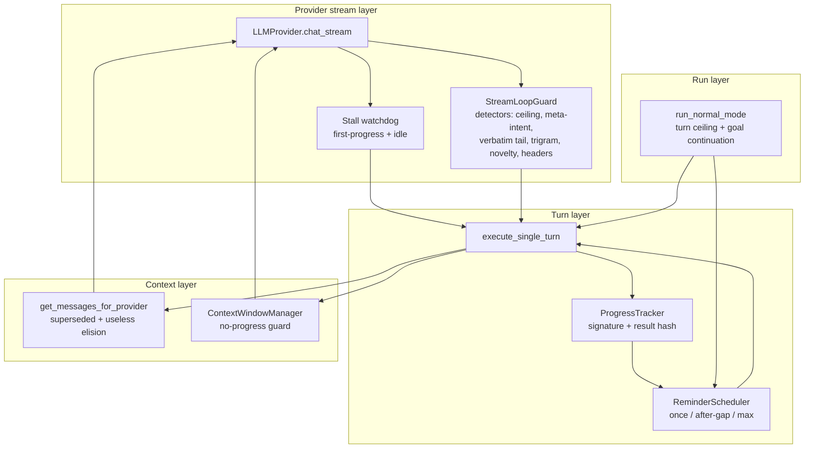

# Anti-Loop Hardening — Design & Implementation Plan

> **Status**: Design spec — NOT YET IMPLEMENTED (2026-10-30).
> Source of the mechanisms: oh-my-pi (`omp` 18.13.1) harness documentation
> shipped at `omp://` (provider-compat-reference, provider-quirks,
> non-compaction-retry-policy, compaction, ttsr-injection-lifecycle,
> advisor-watchdog, tools/todo, tools/wait) and its runtime behaviour.
> Target: Luc Nhan 1.14.1 (`lucnhan/` package, repo root `C:\Users\kiennd14\.rikugan`).

---

## 1. What "anti-loop" means

An agent loops when the same expensive step repeats without changing the state
it is supposed to change. Four distinct layers can loop independently, and each
needs its own detector — a single "max turns" counter only catches the slowest,
most expensive one:

| Layer | Loop shape | Cost per iteration |
| --- | --- | --- |
| Provider stream | reasoning text repeats itself, never reaches a tool call | full token bill, zero output |
| Turn/tool | same tool + same args + same result re-issued | tokens + IDA round-trip |
| Context | compaction runs, reclaims nothing, runs again | tokens + loses history |
| Run | agent yields with work pending, user re-prompts manually | full prompt replay |

OMP addresses all four. Luc Nhan currently addresses only the first (GLM only)
and the last (a hard `max_turns`), plus a 3/5 consecutive-error hint.

---

## 2. OMP's anti-loop inventory (evidence)

### 2.1 Stream-level reasoning-loop guard

`packages/ai/src/utils/thinking-loop.ts` — `ThinkingLoopDetector`, applied by
`withThinkingLoopGuard` in `streamSimple()` (`packages/ai/src/stream.ts`).
Monitored model families: **Gemini, DeepSeek, Grok**. Four detectors, evaluated
on reasoning/thinking deltas **before** the first tool call:

1. **Verbatim tail repetition** — `EXACT_TAIL_WINDOW = 4096` characters,
   trigger at ≥ 180 repeated characters.
2. **Near-duplicate segments** — trigram Jaccard similarity ≥ 0.8 across the
   last 16 segments.
3. **Progress-lexicon stall** — novelty ≤ 0.2 with no new concrete reference
   anchors over 8 consecutive segments.
4. **Header runaway** (Gemini only) — `GEMINI_HEADER_RUNAWAY_THRESHOLD = 24`
   titled reasoning summaries without acting.

On trigger the guard **kills the stream** and raises a retryable
`AIError.Flag.ThinkingLoop`; it does not retry internally. Disable paths:
setting `model.loopGuard.enabled`, env `PI_NO_THINKING_LOOP_GUARD`.

Related provider-level guards: Gemini empty-response retry
(`MAX_EMPTY_STREAM_RETRIES = 2`, exponential backoff, 3 total attempts),
first-progress and idle stream watchdogs (`utils/idle-iterator.ts`), and
`trackLocalWork()` so server-requested local work is not mistaken for a stall.

### 2.2 Retry policy (`TurnRecovery`)

- Classification: only retryable classes; context overflow is excluded and
  delegated to compaction.
- Backoff: `min(baseDelayMs * 2^(attempt-1), 8000ms) * (75–100 % jitter)`,
  `retry.baseDelayMs = 500`, `retry.maxRetries = 10`,
  `retry.maxDelayMs = 300_000`.
- **Replay-safety veto**: committed visible text, images, or tool calls block a
  replay retry. Thinking-only/whitespace-only partials are safe to discard.
- **Thinking-loop redirects stay on the same model**; known thinking-only
  stream-close routes get a **one-retry cap** instead of the full budget.
- **Committed-text stream stall**: keep the partial turn, append a
  `stream-stall-continue.md` developer reminder telling the model to resume
  where it stopped, **max 3 attempts per prompt**.
- Retry counters reset on the first successful non-error, non-aborted message.

### 2.3 Compaction no-progress guard

Maintenance must create real headroom (≤ 80 % of the trigger) before a
continuation is scheduled. If it cannot, it **emits a warning and blocks
automatic continuation rather than resubmitting unchanged history**. Shake
fallback advances to the next method when it reclaims too little, explicitly
"to prevent repeated no-op shake loops".

### 2.4 Tool-result staleness (`compaction.dropUseless`, default on)

- Tools flag contextually useless results (`AgentToolResult.useless`), e.g. a
  search with zero matches or a `wait` safety cap that returned only
  still-running work.
- `pruneSupersededToolResults` blanks them to the exact placeholder
  `[Uneventful result elided]`; **superseded reads are pruned regardless of
  size**, because a later read of the same file makes the earlier one wrong.
- Blanking is in place — tool-call/result pairing and provider replay stay
  intact. Never together with `isError`.

### 2.5 Reminder repeat policy (TTSR)

`ttsr.repeatMode = "once" | "after-gap"`, `ttsr.repeatGap = 10` completed
turns (`messageCount` increments at `turn_end`). Reminders are hidden custom
messages, persisted so a resumed session does not re-fire them.

### 2.6 Advisor cooldown

`advisor.immuneTurns = 3`: after a concern interrupts, further concerns are
downgraded to non-interrupting asides for N primary turns, "including tool-loop
continuations". An emission guard deduplicates notes so the reviewer cannot
review its own advice.

### 2.7 Yield semantics

`agent_end` carries `willContinue`/`yielded`; a terminal answer with queued
work can request one continuation (advisor `continueSeverity`, compaction
`autoContinue`); a `wait` that returns only still-running work is flagged
`useless` instead of being re-polled.

---

## 3. Luc Nhan today (verified in-tree)

| Mechanism | Where | State |
| --- | --- | --- |
| GLM reasoning guard (ceiling 16 384 est. tokens; repetition ≥ 60 % of a ≤ 64-segment window + ≥ 8 meta-intent segments; suppressed by ≥ 256 visible chars or a tool-call start) | `agent/glm_guard.py` | exists, **GLM only** |
| One-shot degeneration recovery (thinking disabled, `max_tokens` capped, request suffix) | `agent/modes/turn_helpers.py::execute_single_turn`, `_build_recovery_context` | exists, max 2 attempts |
| Turn classification | `core/types.py::TurnDisposition`, `loop.py::_classify_turn_outcome` | exists |
| Retry | `agent/loop.py::_stream_llm_turn` (line ≈1064) | `min(2**attempt, 10 s)`, **no jitter**, no empty-response retry |
| Consecutive tool-error hint | `loop.py::_maybe_inject_error_hint` | 3 → hint, 5 → tools disabled for one turn |
| Turn ceiling | `agent/modes/normal.py::_DEFAULT_MAX_TURNS = 100` | exists |
| Read cache | `tools/cache.py::ToolResultCache` | returns identical output; the model still sees it and can loop |
| Compaction | `agent/context_window.py::compact_messages` | no progress check; `should_compact()` re-fires after `reset()` |
| Context pruning | `state/session.py::get_messages_for_provider` | truncation only; no superseded/useless elision |
| Stream watchdog | `providers/base.py::_spawn_cancel_watchdog` | cancellation only; **no idle/first-progress timeout** |
| Repeated-call detection | — | **absent** |
| Reminder scheduler | — | **absent** (ad-hoc messages in `_maybe_inject_error_hint`) |
| Goal continuation | `loop_commands.ACTIVE_GOAL_METADATA_KEY` | goal is stored and prompted, never enforced |

### Gap → OMP mapping

| OMP mechanism | Luc Nhan gap | Priority |
| --- | --- | --- |
| §2.1 stream loop guard | GLM-only, 2 of 5 detectors | P1 |
| §2.2 retry policy | no jitter, no empty retry, stall keeps partial but never continues | P1/P4 |
| §2.3 compaction guard | none | P3 |
| §2.4 useless/superseded pruning | none | P3 |
| §2.5 reminder repeat policy | none | P2 |
| §2.6 cooldown | partial (3/5 error hint, no dedupe) | P2 |
| §2.7 yield semantics | goal never enforced | P5 |
| repeated tool call detection (implied by §2.4/§2.7) | none | P2 |

---

## 4. Target architecture



All new nudges are injected as `Message(role=Role.USER, content="[SYSTEM] …")`,
matching the existing `_maybe_inject_error_hint` convention (there is no
developer role in Luc Nhan). Every nudge goes through `ReminderScheduler` so a
nudge can never become its own loop.

---

## 5. Phase 1 — Generalize the stream loop guard (P1)

### 5.1 New module `lucnhan/agent/loop_guard.py`

Merge `agent/glm_guard.py` into a single detector set (clean cutover — delete
`glm_guard.py`, update imports and tests; do **not** keep two repetition
implementations).

```python
class LoopDetector(Protocol):
    name: str

    def on_reasoning_delta(self, text: str) -> None: ...
    def on_visible_delta(self, text: str) -> None: ...
    def on_tool_call_start(self) -> None: ...
    def trigger(self) -> str: ...  # "" when not latched
    def snapshot(self) -> dict[str, int]: ...


@dataclass(frozen=True)
class LoopGuardProfile:
    ceiling_tokens: int | None
    meta_intent: bool
    verbatim_tail: bool
    trigram_jaccard: bool
    progress_stall: bool
    header_runaway: bool
```

Detectors (all pure, no I/O, bounded memory):

| Detector | Port of | Rule |
| --- | --- | --- |
| `ReasoningCeilingDetector` | existing GLM ceiling | `(utf8_bytes + 2) // 3 >= ceiling_tokens` |
| `MetaIntentRepetitionDetector` | existing GLM repetition path | ≥ 60 % of the last `min(64, n)` segments share a fingerprint **and** ≥ 8 contain an action term + tool term; suppressed by ≥ 256 non-whitespace visible chars or a tool-call start |
| `VerbatimTailDetector` | omp §2.1.1 | keep the last 4096 chars; trigger when the trailing 180-char block already occurs inside that window |
| `TrigramJaccardDetector` | omp §2.1.2 | trigram sets per segment; ≥ 80 % of adjacent pairs among the last 16 segments have Jaccard ≥ 0.8 |
| `ProgressStallDetector` | omp §2.1.3 | novelty (new trigrams ÷ union) ≤ 0.2 for 8 consecutive segments **and** no new anchor (`0x[0-9a-fA-F]+`, `\w+\(`, path-like token) |
| `HeaderRunawayDetector` | omp §2.1.4 | ≥ 24 reasoning lines matching a title pattern without a tool call |

`StreamLoopGuard` aggregates detectors, latches the **first** trigger
(`trigger` stays set — the existing anti-flap behaviour), and exposes
`snapshot()` with `trigger`, `repetition_ratio_millis`, per-detector counters so
`_emit_attempt_telemetry` keeps its current schema.

### 5.2 Profile resolution

`resolve_loop_guard_profile(config, provider_name, model_id)`:

| Family | Profile |
| --- | --- |
| `glm` | ceiling + meta-intent (behavioural parity with 1.14.1) |
| `gemini*`, `deepseek*`, `grok*` | verbatim + trigram + novelty + headers |
| everything else | verbatim + novelty (cheap, low false-positive) |
| `loop_guard_profile = "off"` / `loop_guard_enabled = False` | none |

### 5.3 Wiring changes

- `loop.py::_maybe_create_guard` → `_create_stream_guard(tools_schema)`; drop the
  `is_glm` early return, keep the "tools exposed" gate (a guard only matters
  when the model is supposed to act).
- Delta hooks at `_stream_llm_turn_inner` (currently `guard.on_visible_delta`,
  `on_reasoning_delta`, `on_tool_call_start`, `should_abort`) stay structurally
  identical — only the object changes.
- `TurnDisposition.DEGENERATED` and the recovery path in
  `turn_helpers.execute_single_turn` are already provider-agnostic; the only
  GLM-specific piece is `_build_recovery_context`, see 5.4.

### 5.4 Provider-agnostic thinking suppression

`LLMRequestContext.disable_thinking` is honoured only by
`providers/glm_provider.py`. Extend:

- `openai_provider`: omit `reasoning_effort` / reasoning payload when
  `disable_thinking` (`_parse_thinking_level` already returns `""` for
  `level == "none"` — route the context flag through it).
- `anthropic_provider`: omit the `thinking` request field.
- `gemini_provider`: send `thinkingConfig: {"thinkingBudget": 0}` (or
  `includeThoughts: false` when the endpoint rejects a zero budget).
- `codex_provider`, `ollama_provider`, `minimax_provider`,
  `openai_compat`: no-op, documented.

The recovery suffix and `max_tokens_override` remain universal, so recovery is
never worse than today on providers without a thinking knob.

### 5.5 Retry hardening (`_stream_llm_turn`)

1. **Jitter**: `delay = min(base * 2**(attempt-1), cap) * random.uniform(0.75, 1.0)`.
   New settings `retry_base_delay_ms = 500`, `retry_max_delay_ms = 8000`.
2. **Empty-response retry**: when `_stream_llm_turn_inner` returns
   `TurnDisposition.FAILED` with zero visible text, zero reasoning, zero tool
   calls and no usage, retry up to `_EMPTY_RESPONSE_RETRIES = 2` with backoff
   and a request-local suffix ("Your previous response was empty…"). Safe: no
   committed output exists.
3. **Replay-safety veto** documented and tested: never retry once visible text
   or a completed tool call exists. Keep the existing
   `_is_chunked_read_error` exception (transport noise) explicit.
4. **Thinking-loop cap**: guard-triggered degeneration stays on the same model
   and consumes exactly one recovery attempt (already true) — add a test that a
   second degeneration returns `recovery_failed` without a third request.

### 5.6 Acceptance

- A scripted DeepSeek-style stream that repeats a 200-char reasoning block
  aborts after the verbatim detector latches, performs exactly one recovery
  attempt, persists no assistant message, and emits one `RECOVERY_START`.
- GLM parity: every case in `tests/agent/test_glm_guard.py` passes against the
  new module with identical verdicts.
- `tests/agent/test_glm_recovery.py` passes unchanged except for imports.

---

## 6. Phase 2 — Progress tracker, tool-repeat escalation, reminders (P2)

### 6.1 `lucnhan/agent/progress.py`

```python
@dataclass(frozen=True)
class ToolCallSignature:
    name: str
    args_hash: str            # sha256 of json.dumps(args, sort_keys=True, default=str)

class ProgressTracker:
    def observe_tool_result(self, tc: ToolCall, content: str, is_error: bool) -> RepeatVerdict
    def observe_turn(self, *, tool_calls, assistant_text, results) -> TurnVerdict
    def reset_user_turn(self) -> None
    def run_made_progress(self) -> bool
```

- Ring buffer of the last 32 `(signature, result_hash, turn, is_error)`.
- `RepeatVerdict(kind=NONE|REPEAT|REPEAT_IDENTICAL_RESULT, occurrences, tool)`.
- Escalation thresholds (config, defaults matching the 3/5/8 ladder):
  `tool_repeat_warn_at = 3` (same signature within the last 12 calls) →
  reminder; `tool_repeat_block_at = 5` (or 2 with an identical result hash) →
  the tool is removed from the next turn's schema and rejected with an error
  result; `tool_repeat_stop_at = 8` → `_tools_disabled_for_turn = True` and a
  forced explanation turn.
- `run_made_progress()` is true when any mutating tool succeeded, any
  previously unseen address/function appeared in a result, or the assistant
  produced new text — used by the goal continuation (Phase 5).
- Reset on every new user message, and unblock a tool on any successful
  mutation (the state it was stuck on may have changed).

### 6.2 `lucnhan/agent/reminders.py`

```python
class ReminderKind(str, Enum):
    TOOL_REPEAT, NO_PROGRESS, STREAM_STALL, EMPTY_RESPONSE, GOAL_PENDING

@dataclass(frozen=True)
class ReminderPolicy:
    max_per_run: int
    min_gap_turns: int

class ReminderScheduler:
    def should_emit(self, kind: ReminderKind, turn: int) -> bool
    def mark_emitted(self, kind: ReminderKind, turn: int) -> None
    def reset_run(self) -> None
```

Defaults (OMP parity where it exists): `TOOL_REPEAT (2, 2)`,
`NO_PROGRESS (1, 5)`, `STREAM_STALL (3, 1)` — OMP's "3 per prompt",
`EMPTY_RESPONSE (2, 1)`, `GOAL_PENDING (1, 0)`.
Reminder texts are module-level constants with the `[SYSTEM] ` prefix baked in;
no untrusted data is interpolated (tool names are validated against the
registry before use).

### 6.3 Wiring

- `AgentLoop.__init__`: `self._progress = ProgressTracker(...)`,
  `self._reminders = ReminderScheduler(...)`,
  `self._blocked_tools: set[str] = set()`.
- `_execute_tool_calls` / `_execute_single_tool`: call
  `self._progress.observe_tool_result(...)` after `sanitize_tool_result`, then
  emit via `_reminders` (single injection point).
- `_build_tools_schema`: subtract `self._blocked_tools`.
- `_execute_single_tool`: reject a blocked tool with
  `"Error: tool '<name>' is blocked for this turn after N identical calls. Use a different approach or explain what is failing."`.
- `_maybe_inject_error_hint` is re-expressed through `ReminderScheduler`
  (kinds `NO_PROGRESS`), keeping its 3/5 behaviour as the policy values.

### 6.4 Acceptance

- Three identical `decompile_function` calls in one run produce exactly one
  reminder; five produce a blocked tool that is absent from the schema and
  errors when called; eight disable tools for one turn.
- A different argument or a successful mutation resets the counter.
- A new user message clears blocks and per-run reminder counts.

---

## 7. Phase 3 — Context-layer anti-loop (P3)

### 7.1 Useless-result flagging

- `core/types.py`: `ToolResult.useless: bool = False`.
- New `tools/useless.py::classify_useless(tool_name, content) -> bool`,
  allowlist-based (no generic heuristics): zero-match `search_strings`,
  empty `xrefs_to`/`xrefs_from`, empty `get_function_comment`,
  `list_functions` returning zero rows.
- Set in `_execute_single_tool` next to `is_error` (never together with
  `is_error` — errors win).

### 7.2 Pruning in `state/session.py::get_messages_for_provider`

Add `_prune_stale_tool_results(messages)` before the existing truncation pass:

1. **Superseded reads**: key = `(tool_name, normalized path/address argument)`.
   An earlier result for the same key is blanked to
   `[Superseded by later read]` — a later read makes the earlier one wrong,
   exactly OMP's rationale.
2. **Useless results**: blanked to `[Uneventful result elided]` once they are
   older than the last completed turn.
3. Never touch the last `_KEEP_TAIL = 4` messages; blank `content` only, keep
   the `Message` and its `tool_call_id` so provider pairing stays valid.
4. Gated by `config.drop_useless_results` (default `True`) and skipped entirely
   when `config.preserve_context` is set.

### 7.3 Compaction no-progress guard

`_prepare_provider_messages` (loop.py, ≈ line 1170):

- Record `before = self._context_manager._total_tokens` (add a read-only
  `total_tokens` property), compact, re-estimate; `reduced = after < before * 0.9`.
- `self._compaction_no_progress` increments when not reduced, resets on
  reduction.
- At 2 consecutive no-progress passes: set
  `self._compaction_suspended = True`, emit **one**
  `TurnEvent.error_event("Context compaction is not reducing the conversation; continuing without further automatic compaction.")`,
  and skip `should_compact()` until the message count grows by ≥ 20 % or the
  user runs a manual compaction. This is OMP's "block automatic continuation
  rather than resubmit unchanged history", applied to the compaction trigger.

### 7.4 Acceptance

- Two reads of the same function: the first is blanked, the second is intact,
  pairing preserved (`tool_call_id` still present).
- A zero-match search older than one turn is elided; a fresh one is not.
- A compaction pass that shrinks nothing twice suspends auto-compaction, emits
  one warning, and re-arms after history growth.
- `preserve_context = True` disables both behaviours.

---

## 8. Phase 4 — Stream stall watchdog (P4)

`providers/base.py`:

- Extend the existing watchdog pattern (`_spawn_cancel_watchdog`) with a
  **progress watchdog** thread per request: the consumer bumps
  `last_chunk_monotonic`; the thread closes the stream when
  - no first chunk within `stream_first_progress_timeout_seconds` (default 120), or
  - no chunk within `stream_idle_timeout_seconds` (default 90).
- The consumer raises `ProviderError(..., retryable=True, kind="stream_stall")`.
- `0` disables either timeout; both validated to `0` or `[5, 3600]`.
- The thread is daemon, is released by the existing per-request `done` event,
  and never blocks cancellation (CLAUDE.md: `_check_cancelled` in every new
  blocking wait).

Turn-layer handling in `_stream_llm_turn_inner`:

- Stall **before** any committed text → re-raise so `_stream_llm_turn` retries
  with backoff.
- Stall **after** committed text → keep the partial assistant message, emit
  one `STREAM_STALL` reminder ("resume exactly where you stopped; do not repeat
  the text already shown"), and continue the same run — max 3 per prompt via
  `ReminderScheduler`. This is the OMP `stream-stall-continue` path and removes
  the current dead-end where a broken stream just warns.

### 8.1 Acceptance

- A fake provider that hangs after the first chunk raises a retryable stall
  within the configured idle timeout.
- A stall after partial text keeps the text, emits exactly one reminder, and
  the third occurrence ends the run with a visible error.

---

## 9. Phase 5 — Run-layer continuation and surface (P5)

### 9.1 Goal continuation

In `agent/modes/normal.py`, on the terminal branch
(`not result.has_tool_calls`):

```python
if (
    self.config.goal_continuation_enabled
    and loop.session.metadata.get(ACTIVE_GOAL_METADATA_KEY)
    and not loop._progress.run_made_progress()
    and loop._reminders.should_emit(ReminderKind.GOAL_PENDING, turn)
):
    loop.session.add_message(Message(role=Role.USER, content=GOAL_CONTINUE_REMINDER))
    continue  # one extra turn
```

Capped at one per goal per run; never fires when the goal was just set in this
run (`cmd.goal_to_set`), when the run is cancelled, or in plan mode.

### 9.2 Config, UI, docs

`core/config.py::LucNhanConfig` (with `load()`, `validate()`, `save()`):

| Field | Default | Range / values |
| --- | --- | --- |
| `loop_guard_enabled` | `True` | bool |
| `loop_guard_profile` | `"auto"` | `auto` / `full` / `glm` / `off` |
| `tool_repeat_warn_at` | `3` | 2–20 |
| `tool_repeat_block_at` | `5` | 3–40, > warn |
| `tool_repeat_stop_at` | `8` | 4–60, > block |
| `drop_useless_results` | `True` | bool |
| `stream_idle_timeout_seconds` | `90` | 0 or 5–3600 |
| `stream_first_progress_timeout_seconds` | `120` | 0 or 5–3600 |
| `retry_base_delay_ms` | `500` | 100–10 000 |
| `retry_max_delay_ms` | `8000` | 500–300 000 |
| `goal_continuation_enabled` | `True` | bool |

`ui/settings_dialog.py`: add the four user-facing toggles to
`_build_behavior_group()` (guard on/off, repeat thresholds as one spin row,
drop-useless toggle, goal continuation) and wire them in `_on_accept()`.
Timeouts and backoff stay config-file-only (they are provider-tuning, not
user-facing).

Docs: `CHANGELOG.md` under `[Unreleased] / Changed`, a short
`ARCHITECTURE.md` subsection under "Context window", and this file flipped to
"IMPLEMENTED (date)".

---

## 10. Tests

New / updated files under `tests/`:

| File | Covers |
| --- | --- |
| `tests/agent/test_loop_guard.py` (replaces `test_glm_guard.py`) | all six detectors, latch semantics, bounded memory, profile resolution, visible/tool-call suppression |
| `tests/agent/test_glm_recovery.py` (imports only) | two-attempt ceiling, no third request, history untouched |
| `tests/agent/test_progress_tracker.py` | signature hashing, warn/block/stop ladder, identical-result rule, resets |
| `tests/agent/test_reminders.py` | once / after-gap / max-per-run, reset |
| `tests/agent/test_loop_repeat_guard.py` | end-to-end through `_execute_tool_calls` with a fake registry |
| `tests/agent/test_session_pruning.py` | superseded blanking, useless elision, pairing intact, tail untouched, `preserve_context` |
| `tests/agent/test_stream_stall.py` | first-progress and idle timeouts, retry vs continue split, 3-per-prompt cap |
| `tests/agent/test_empty_response_retry.py` | 2 retries with suffix, then error; no retry when text was committed |
| `tests/agent/test_compaction_no_progress.py` | suspension, single warning, re-arm on growth |
| `tests/providers/test_disable_thinking.py` | OpenAI/Anthropic/Gemini request shapes under recovery |

All tests stub IDA (`tests/mocks/ida_mock.py`) — no IDA Pro needed.

---

## 11. Risks and mitigations

| Risk | Mitigation |
| --- | --- |
| Repetition detectors fire on legitimate long reasoning (e.g. decompiler walk-throughs) | visible-text and tool-start suppression (existing), per-family profiles, conservative defaults, `loop_guard_profile = "off"` escape hatch, telemetry counter per detector |
| Tool blocking deadlocks a legitimate retry after external state changed | blocks reset on a new user turn and on any successful mutating tool |
| Blanking tool results breaks provider pairing or hides evidence | content-only blanking, messages never removed, tail protected, tests assert `tool_call_id` survival |
| Nudges themselves become a loop | every nudge is scheduled through `ReminderScheduler` (max + gap), never emitted inline |
| Stall watchdog closes healthy slow streams | 120 s first-progress / 90 s idle are far above observed p99; both configurable, `0` disables |
| Config surface growth | 11 fields, 4 in the UI, all default-on but individually disableable; `validate()` clamps |
| Extra per-delta CPU | detectors are O(window) with hard caps (4096-char tail, 128-segment ring, 16-segment trigram window) |

---

## 12. Verification

Per phase, then once at the end:

```bash
python -m pytest tests/agent tests/providers -q
./ci-local.sh                      # format + lint + mypy + pytest + desloppify (baseline 89.0, −0.5 tolerance)
```

Behavioural smoke (no IDA required):

1. `tests/agent/test_loop_guard.py` drives a scripted degenerate stream through
   `AgentLoop._stream_llm_turn_inner` with a fake provider and asserts one
   recovery attempt, no persisted assistant message, and one telemetry record
   with `guard_trigger` set.
2. `tests/agent/test_loop_repeat_guard.py` drives `AgentLoop.run` against a fake
   provider that emits the same `decompile_function` call four times and
   asserts the reminder, the blocked-tool error, and the final stop.
3. `python -m lucnhan.cli.headless ask <sample> "<prompt>"` on a real binary is
   the manual acceptance run for the stream watchdog and pruning phases
   (requires `IDA_PATH`).

---

## 13. Non-goals

- No TTSR rule engine (user-authored regex rules over the stream) — the
  detector set covers the loop cases; a rule engine is a separate feature.
- No advisor/reviewer model — Luc Nhan's `report_review` and
  `hypothesis_verification` loops already bound themselves (`max_cycles`,
  `max_attempts`).
- No model fallback chains — `max_retries` plus the existing provider config is
  the supported recovery surface.
- No changes to `execute_python` approval, mutation tracking, or sanitization
  paths.
